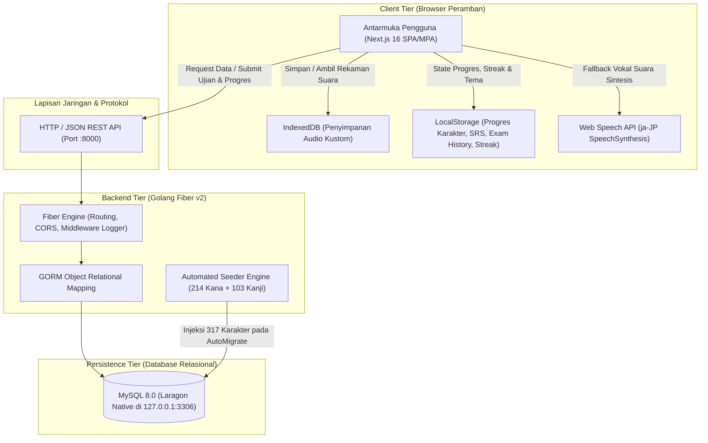
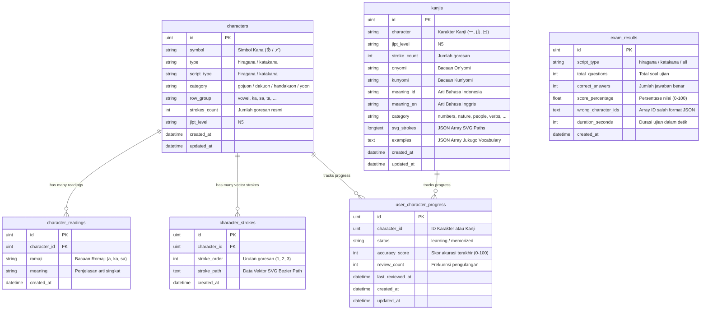

# MASTER PRODUCT REQUIREMENT DOCUMENT (PRD)
# Platform Nihongo Sora (日本語の空)

<div align="center">


<br />
**Dokumen Spesifikasi Produk & Arsitektur Induk — Platform Edukasi Kaligrafi Digital, Penguasaan Aksara Kana (214 Karakter) & Kanji JLPT N5 (103 Karakter)**

*Versi Dokumen: 2.0.0 (Fase 11 Complete) | Status: Approved & Production Ready | Klasifikasi: Master Architecture & Product Guide*

</div>

---

## 📑 DAFTAR ISI

1. [Ringkasan Eksekutif & Visi Produk](#1-ringkasan-eksekutif--visi-produk)
   - 1.1 Visi & Nilai Inti (*Core Values*)
   - 1.2 Masalah Pasar & Analisis Kebutuhan
   - 1.3 Profil Target Pengguna (*User Personas*)
   - 1.4 Proposisi Nilai Unggulan (*Unique Value Propositions*)
2. [Arsitektur Sistem & Spesifikasi Teknologi (Decoupled Monorepo)](#2-arsitektur-sistem--spesifikasi-teknologi-decoupled-monorepo)
   - 2.1 Arsitektur Tingkat Tinggi (*High-Level Architecture*)
   - 2.2 Arsitektur Frontend (*Next.js 16 App Router + React 19*)
   - 2.3 Arsitektur Backend (*Golang Fiber v2 + GORM*)
   - 2.4 Database & Persistence Layer (*MySQL 8.0 + IndexedDB + LocalStorage*)
   - 2.5 Resiliensi Sistem (*Offline-First Hybrid Resilience*)
3. [Spesifikasi Kurikulum & Dataset Master (317 Karakter)](#3-spesifikasi-kurikulum--dataset-master-317-karakter)
   - 3.1 Dataset Hiragana (107 Karakter)
   - 3.2 Dataset Katakana (107 Karakter)
   - 3.3 Dataset Kanji JLPT N5 (103 Karakter)
   - 3.4 Standar Ortografi KanjiVG & Spesifikasi Kurva Vektor SVG
4. [Spesifikasi Fitur Fungsional Inti (Functional Requirements)](#4-spesifikasi-fitur-fungsional-inti-functional-requirements)
   - 4.1 FR-1: Interactive Calligraphy Studio (Hitsujun Engine & Hausdorff Scorer)
   - 4.2 FR-2: Arena Ujian & Kuis Evaluasi Adaptif (/exam)
   - 4.3 FR-3: Smart Spaced Repetition System (SRS Engine)
   - 4.4 FR-4: Sistem Gamifikasi, Leveling, XP & Daily Streak
   - 4.5 FR-5: Hybrid 3-Tier Audio Engine & IndexedDB Custom Voice
   - 4.6 FR-6: Dasbor Statistik & Analitik Belajar (/analytics)
   - 4.7 FR-7: Sistem Lokalisasi Bilingual Instan (ID / EN)
   - 4.8 FR-8: Dynamic Atmospheric Aesthetic (Sora Sky Animation & Sakura Rain)
   - 4.9 FR-9: Manajemen Sesi, Sinkronisasi & Atomic Hard Reset System
5. [Spesifikasi Persyaratan Non-Fungsional (Non-Functional Requirements)](#5-spesifikasi-persyaratan-non-fungsional-non-functional-requirements)
   - 5.1 Performa & Latensi (Performance & Latency)
   - 5.2 Aksesibilitas Web (WCAG 2.1 AA Compliance)
   - 5.3 Keamanan Sistem & Sanitasi Data (Security & Data Integrity)
   - 5.4 Keandalan & Kompatibilitas Perangkat (Cross-Device Compatibility)
6. [Skema Basis Data & Kamus Data Relasional](#6-skema-basis-data--kamus-data-relasional)
   - 6.1 Diagram Relasi Entitas (ERD)
   - 6.2 Struktur Tabel Basis Data MySQL
7. [Spesifikasi Lengkap Kontrak REST API (Backend Golang Fiber)](#7-spesifikasi-lengkap-kontrak-rest-api-backend-golang-fiber)
   - 7.1 Kelompok Endpoint Karakter & Kanji
   - 7.2 Kelompok Endpoint Progres & Antrean Latihan SRS
   - 7.3 Kelompok Endpoint Ujian & Riwayat Kuis
   - 7.4 Kelompok Endpoint Analitik & Agregasi Data
   - 7.5 Format Standar Respon API
8. [Rekam Jejak Evolusi Pengembangan Produk (Fase 1 s/d Fase 11)](#8-rekam-jejak-evolusi-pengembangan-produk-fase-1-sd-fase-11)
9. [Panduan Operasional, Deployment & Pemulihan Sistem](#9-panduan-operasional-deployment--pemulihan-sistem)

---

## 1. RINGKASAN EKSEKUTIF & VISI PRODUK

### 1.1 Visi & Nilai Inti (*Core Values*)
**Nihongo Sora (日本語の空 - Langit Bahasa Jepang)** adalah platform perangkat lunak pembelajaran aksara Jepang full-stack modern yang mengintegrasikan seni kaligrafi tradisional Jepang (*Shodo* / 書道) dengan kecerdasan komputasi web interaktif dan prinsip psikologi memori spasial.

> **Slogan & Filosofi Produk:**
> *"Belajar bahasa Jepang dengan gembira — santai tapi serius, serius tapi santai."*

Nilai-nilai fundamental yang menjiwai arsitektur dan antarmuka produk:
- **Gembira & Ringan di Hati (*Joyful Learning*)**: Menghilangkan kecemasan belajar aksara asing (*Kanji/Kana anxiety*) melalui estetika visual langit (*Sora* / 空), animasi mikro awan berarak yang menenangkan, serta efek kelopak bunga sakura yang lembut.
- **Presisi Kaligrafi Ortodoks (*Hitsujun Precision*)**: Menegakkan kepatuhan urutan goresan resmi (*Hitsujun* / 筆順) berstandar Kementerian Pendidikan Jepang (MEXT) melalui kurva vektor KanjiVG resmi, melatih memori otot (*muscle memory*) sejak goresan paling awal.
- **Efisiensi Memori Spasial (*Scientific Retention*)**: Memaksimalkan retensi jangka panjang melalui pengulangan berkala adaptif (*Spaced Repetition System* / SRS) yang otomatis memprioritaskan karakter yang belum stabil.
- **Otonomi Pengguna (*Learner Sovereignty*)**: Memberikan kendali penuh kepada pembelajar untuk mengkustomisasi suara pelafalan (termasuk mengunggah audio rekaman sendiri) hingga hak penuh melakukan reset progres atomik secara mandiri.

### 1.2 Masalah Pasar & Analisis Kebutuhan
| Tantangan Konvensional | Solusi Inovatif Nihongo Sora |
| :--- | :--- |
| **Hafalan Pasif (Flashcard Textual)**: Pembelajar hanya melihat karakter statis tanpa memahami anatomi goresan kuas, memicu kebiasaan menulis goresan terbalik yang sulit diperbaiki. | **Interactive Hitsujun Studio**: Kanvas kuas HTML5 dengan kurva panduan dinamis, penomoran titik awal goresan, dan evaluasi geometri Hausdorff waktu nyata. |
| **Ketergantungan Kuota/Audio Terputus**: Aplikasi daring sering kali gagal memutar audio saat jaringan lambat atau file CDN terhapus. | **Hybrid 3-Tier Audio Engine**: Pemutaran cerdas otomatis memilih IndexedDB Kustom $\rightarrow$ File Audio Lokal $\rightarrow$ Web Speech Synthesis. |
| **Kehilangan Motivasi Cepat**: Ketiadaan indikator progres visual yang transparan membuat pembelajar merasa berjalan di tempat. | **Gamifikasi Terpadu & Streak**: Akumulasi XP per goresan kuas, visualisasi kenaikan level, daily streak tracker, dan matriks penguasaan baris huruf. |
| **Tampilan Kaku & Membosankan**: Platform edukasi bahasa Jepang mayoritas menggunakan antarmuka datar tanpa nuansa kultural yang hidup. | **Dynamic Atmospheric Aesthetic**: Latar animasi langit dinamis adaptif (siang cerah & senja malam) berpadu partikel sakura melayang 60 FPS. |

### 1.3 Profil Target Pengguna (*User Personas*)
- **Persona A: "Kenji - Pelajar Mandiri & Peminat Anime/Budaya"**: Usia 16–25 tahun, akrab dengan antarmuka digital modern, belajar secara otodidak. Kebutuhan: membaca teks Hiragana & Katakana di media populer, antarmuka yang keren dan menyejukkan mata.
- **Persona B: "Siti - Mahasiswa Sastra Jepang / Calon Peserta JLPT N5"**: Usia 19–24 tahun, membutuhkan sertifikasi JLPT resmi dan keakuratan ortografi goresan Kanji. Kebutuhan: menguasai 103 Kanji N5 (Onyomi, Kunyomi, Arti), mengetahui urutan goresan presisi untuk ujian tulis, serta mengevaluasi akurasi.
- **Persona C: "Budi - Profesional yang Mengulang Pelajaran Bahasa"**: Usia 28–45 tahun, waktu terbatas (15–30 menit sehari) dan membutuhkan pembelajaran terfokus tanpa distraksi. Kebutuhan: latihan kilat karakter yang sering lupa tanpa memilih huruf satu per satu secara manual.

### 1.4 Proposisi Nilai Unggulan (*Unique Value Propositions*)
1. **Kurikulum Terbesar di Kelasnya (317 Karakter)**: 107 Hiragana + 107 Katakana + 103 Kanji JLPT N5 terverifikasi penuh dengan koordinat vektor KanjiVG.
2. **Mesin Evaluasi Goresan Matematika Asli**: Mengombinasikan algoritma jarak Euclidean titik-ke-kurva dan jarak Hausdorff untuk menghitung akurasi 0–100% tanpa lag komputasi.
3. **Arsitektur Decoupled Tahan Banting**: Frontend Next.js 16 tetap berfungsi 100% penuh menggunakan cache LocalStorage dan IndexedDB bahkan saat backend Go dimatikan (*zero-downtime client resilience*).
4. **Desain Kelas Dunia**: Tampilan visual bertaraf anime visual novel dengan estetika langit Sora, tipografi shodo, dan kelopak sakura organik yang diakselerasi GPU.

---

## 2. ARSITEKTUR SISTEM & SPESIFIKASI TEKNOLOGI (DECOUPLED MONOREPO)

Aplikasi Nihongo Sora mengadopsi pola arsitektur **Decoupled Monorepo**. Kode sumber frontend dan backend dikelola dalam satu repositori kerja namun terisolasi secara runtime, konfigurasi build, dan dependensi pustaka.



### 2.1 Arsitektur Frontend (`frontend-next`)
- **Framework Utama**: **Next.js 16.4.0** (App Router dengan compiler **Turbopack**).
- **Core UI Engine**: **React 19** (Client Components dengan Server Side Metadata).
- **Sistem Bahasa**: **TypeScript 5.x** (Strict Type Checking, interface terpadu).
- **Styling & Desain**: **Tailwind CSS v4** dengan modul `@custom-variant dark`.
- **Manajemen Tema**: `next-themes` (Dark Mode, Light Mode, dan System Synchronized).
- **Kanvas & Grafis**: Native HTML5 Canvas 2D Context + Dynamic SVG Bezier Kurva KanjiVG.
- **Penyimpanan Klien**:
  - `IndexedDB` (`nihongo_sora_audio_db`): Menyimpan blob audio kustom pengguna hingga puluhan megabyte tanpa batasan kuota LocalStorage.
  - `LocalStorage`: Menyimpan progres hafalan (`nihongo_sora_character_progress`), streak harian (`nihongo_sora_daily_streak`), riwayat kuis (`nihongo_sora_exam_history`), dan toggle efek sakura (`nihongo_sora_sakura_rain`).

### 2.2 Arsitektur Backend (`backend-go`)
- **Bahasa Komputasi**: **Golang 1.22+** (Menghasilkan binary native dengan jejak memori < 20MB dan waktu start < 50ms).
- **Web Framework**: **Go Fiber v2** (`github.com/gofiber/fiber/v2`) berbasis `fasthttp`.
- **Database ORM**: **GORM** (`gorm.io/gorm` & driver `gorm.io/driver/mysql`).
- **Middleware Terpasang**:
  - `fiber/middleware/cors`: Mengizinkan komunikasi lintas domain dengan Next.js (`http://localhost:3000`).
  - `fiber/middleware/logger`: Logging akses HTTP mendetail untuk audit latency endpoint.
  - `fiber/middleware/recover`: Pencegahan crash server otomatis terhadap runtime panic.
- **Konfigurasi Lingkungan**: Parsing variabel `.env` mandiri (`PORT`, `DB_HOST`, `DB_PORT`, `DB_USERNAME`, `DB_PASSWORD`, `DB_DATABASE`).

### 2.3 Resiliensi Sistem (*Offline-First Hybrid Resilience*)
Nihongo Sora dirancang dengan prinsip keandalan tinggi:
1. **Fallback Data Statis**: Jika server backend Golang tidak aktif (status `isBackendLive === false`), frontend otomatis beralih menggunakan dataset JSON statis lokal di `src/data/`: `hiragana_107.json`, `katakana_107.json`, dan `kanji_n5_batch1.json`.
2. **Penyimpanan Progres Lokal**: Perubahan progres hafalan dan skor ujian selalu dicatat ke `localStorage` terlebih dahulu sebelum dikirim secara asinkron ke endpoint `/api/progress/update` atau `/api/exam/submit`.
3. **Indikator Live Transparan**: Pill badge di Navbar secara cerdas menampilkan status koneksi:
   - `● Fiber Live (X ms)`: Terhubung penuh ke database MySQL via Go backend.
   - `○ Offline Mode`: Berjalan mandiri tanpa backend dengan fungsionalitas tracing, audio, dan kuis tetap aktif 100%.

---

## 3. SPESIFIKASI KURIKULUM & DATASET MASTER (317 KARAKTER)

Aplikasi Nihongo Sora menyajikan kurikulum terlengkap yang mencakup **317 karakter bahasa Jepang**:

```
TOTAL DATASET: 317 KARAKTER
├── 1. Hiragana (107 Karakter)
│   ├── Gojuon (46 Karakter Dasar: Vokal, Ka, Sa, Ta, Na, Ha, Ma, Ya, Ra, Wa, N)
│   ├── Dakuon (20 Karakter Suara Keruh: Ga, Za, Da, Ba)
│   ├── Handakuon (5 Karakter Suara Setengah Keruh: Pa)
│   └── Yoon (36 Karakter Diftong Gabungan: Kya, Shu, Cho, dll.)
├── 2. Katakana (107 Karakter)
│   ├── Gojuon (46 Karakter Dasar)
│   ├── Dakuon (20 Karakter Suara Keruh)
│   ├── Handakuon (5 Karakter Suara Setengah Keruh)
│   └── Yoon (36 Karakter Diftong Gabungan)
└── 3. Kanji JLPT N5 (103 Karakter Lengkap)
    ├── Batch 1: Angka & Penanggalan (一, 二, 三, 日, 月, 火, ...) [26 Karakter]
    ├── Batch 2: Manusia, Tubuh, Arah & Ukuran (人, 子, 目, 口, 上, 下, 大, 小, ...) [25 Karakter]
    ├── Batch 3: Alam, Sekolah, Tempat & Hewan (山, 川, 天, 気, 校, 学, 犬, 魚, ...) [27 Karakter]
    └── Batch 4: Kata Kerja, Sifat, & Arah Mata Angin (行, 来, 見, 食, 東, 西, 南, 北, ...) [25 Karakter]
```

### 3.1 Spesifikasi Struktur Data Karakter
Setiap karakter diatur oleh skema data TypeScript dan Golang yang ketat:
```typescript
interface CharacterData {
  id: number
  character: string          // Simbol harfiah (misal: "あ", "ア", atau "山")
  symbol?: string            // Alias kompatibilitas
  type: 'hiragana' | 'katakana' | 'kanji'
  script_type: 'hiragana' | 'katakana' | 'kanji'
  category: string           // 'gojuon' | 'dakuon' | 'handakuon' | 'yoon' | 'numbers' | 'nature' | dll.
  row_group?: string         // 'vowel' | 'ka' | 'sa' | 'ta' | dll.
  strokes_count: number      // Jumlah goresan resmi
  jlpt_level?: 'N5' | 'N4'
  readings: Array<{
    romaji: string           // Bacaan alfabetik
    meaning?: string         // Penjelasan makna dalam Bahasa Indonesia/Inggris
  }>
  onyomi?: string            // Khusus Kanji (misal: "サン (SAN)")
  kunyomi?: string           // Khusus Kanji (misal: "やま (yama)")
  meaning_id?: string        // Terjemahan Bahasa Indonesia
  meaning_en?: string        // Terjemahan Bahasa Inggris
  strokes: Array<{
    stroke_order: number     // Urutan nomor goresan (1, 2, 3, ...)
    svg_path: string         // Path koordinat kurva bezier SVG KanjiVG murni
  }>
}
```

### 3.2 Standar Ortografi KanjiVG & Spesifikasi Kurva Vektor SVG
- Seluruh kurva goresan bersumber dari proyek riset **KanjiVG (Ulrich Apel)** yang dipetakan dalam koordinat viewBox baku $109 \times 109$.
- Kurva diuraikan menggunakan perintah SVG Path standar (`M`, `C`, `S`, `Q`, `L`, `Z`), memungkinkan interpolasi titik koordinat presisi tinggi untuk evaluasi memori otot.

---

## 4. SPESIFIKASI FITUR FUNGSIONAL INTI (FUNCTIONAL REQUIREMENTS)

### 4.1 FR-1: Interactive Calligraphy Studio (Hitsujun Engine & Hausdorff Scorer)
- **Komponen Utama**: `src/components/StrokeCanvas.tsx`
- **Grid Garis Bantu Tradisional**: Kanvas berukuran $320 \times 320$ piksel dilengkapi garis silang putus-putus berstandar kertas latihan kaligrafi Jepang (*Genko Yoshi* / 原稿用紙).
- **Mode Panduan Berjenjang**:
  1. *Panduan Penuh (Guide ON)*: Menampilkan siluet abu-abu transparan dari seluruh path karakter beserta penomoran urutan goresan `#1`, `#2`, `#3` di titik koordinat mula goresan.
  2. *Panduan Buta (Guide OFF / Blind Mode)*: Menyembunyikan seluruh garis bantu untuk menguji daya ingat goresan kuas pengguna secara murni.
- **Algoritma Evaluasi Presisi Goresan Kuas**:
  - Mengambil koordinat titik sampel yang digambar pengguna melalui Pointer Events (`pointerdown`, `pointermove`, `pointerup`).
  - Menghitung deviasi geometris terhadap kurva bezier KanjiVG menggunakan kombinasi **Jarak Euclidean Titik Terdekat** dan **Jarak Hausdorff**.
  - Menghitung akurasi 0% hingga 100%:
    $$\text{Score} = \max\left(0, 100 - \frac{\sum_{i=1}^{N} \text{dist}(p_i, \text{Path}_{\text{ref}})}{N \times \text{Toleransi}} \times 100\right)$$
  - Pemberian Predikat:
    - $\ge 85\%$: **Sempurna (Grade S / A)** $\rightarrow$ Memberikan $+15\text{ XP}$.
    - $70\% - 84\%$: **Bagus (Grade B)** $\rightarrow$ Memberikan $+10\text{ XP}$.
    - $< 70\%$: **Perlu Dilatih (Grade C / D)** $\rightarrow$ Masuk antrean Spaced Repetition (SRS).

### 4.2 FR-2: Arena Ujian & Kuis Evaluasi Adaptif (`/exam`)
- **Komponen Utama**: `src/app/exam/page.tsx`
- **Pengaturan Fleksibel**:
  - Pemilihan Aksara: Hiragana, Katakana, atau Kombinasi Keduanya.
  - Jumlah Soal: 10 Soal (Latihan Cepat), 20 Soal (Standar), atau 40 Soal (Ujian Penuh).
  - Mode Soal:
    1. *Romaji $\rightarrow$ Kana*: Diberikan bacaan alfabetis (misal: "mizu"), pengguna memilih simbol karakter yang tepat.
    2. *Kana $\rightarrow$ Romaji*: Diberikan simbol aksara Jepang, pengguna memilih bacaan romaji yang benar.
    3. *Audio Listening Quiz*: Memutar suara pelafalan, pengguna menebak karakter yang diperdengarkan.
- **Pengatur Waktu Cerdas (*Dynamic Timer*)**: Batas waktu 15 detik per pertanyaan dengan visual bar yang menyusut.
- **Pencatatan Hasil Ujian**:
  - Skor persentase kelulusan ($0 - 100\%$).
  - Kelulusan ambang batas: $\ge 70\%$.
  - Otomatis mencatat daftar `wrong_character_ids` ke database backend (`POST /api/exam/submit`) untuk diteruskan ke engine SRS.

### 4.3 FR-3: Smart Spaced Repetition System (SRS Engine)
- **Utilitas**: `src/utils/srs.ts`
- **Kriteria Otomatis Karakter Perlu Diulang (*Needs Review*)**:
  1. Skor akurasi tracing terakhir $< 70\%$.
  2. Karakter dijawab salah pada sesi kuis/ujian terakhir.
  3. Karakter yang belum pernah dilatih sama sekali.
- **Antrean Latihan Prioritas Adaptif**:
  - Di halaman Beranda (`/`), tombol **"Latihan Kilat Huruf Lemah"** otomatis memuat karakter terlemah pertama yang memerlukan penanganan segera.
  - Filter kustom `filter=needs_review` tersedia di Studio Latihan dan Katalog Belajar.

### 4.4 FR-4: Sistem Gamifikasi, Leveling, XP & Daily Streak
- **Konteks & Utilitas**: `src/context/GamificationContext.tsx` & `src/utils/gamification.ts`
- **Formula Level & XP**:
  - Tiap Level membutuhkan $100\text{ XP}$ konstan untuk naik ke tingkat berikutnya:
    $$\text{Level} = \left\lfloor \frac{\text{CurrentXP}}{100} \right\rfloor + 1$$
  - Gelar Kenaikan Level:
    - Level 1: *Pemula Aksara (Shoshinsha / 初心者)*
    - Level 3: *Penjelajah Kana (Tabibito / 旅人)*
    - Level 5: *Praktisi Kuas (Fudetsukai / 筆使い)*
    - Level 10: *Pendekar Shodo (Kendo / 剣道)*
    - Level 20+: *Master Sora (Sora no Tatsujin / 空の達人)*
- **Daily Streak Engine**:
  - Mencatat stempel waktu hari aktif belajar (`YYYY-MM-DD`).
  - Jika pengguna belajar berturut-turut pada hari berikutnya, streak bertambah $+1$.
  - Jika terlewat $> 1$ hari, streak otomatis kembali ke $1$.
  - Indikator api animasi menyala di bilah navigasi utama.

### 4.5 FR-5: Hybrid 3-Tier Audio Engine & IndexedDB Custom Voice
- **Utilitas**: `src/utils/audio.ts` & `src/utils/audioStorage.ts`
- **Mekanisme Hierarki 3-Tier**:
  ```
  [Permintaan Putar Suara Karakter]
                 │
                 ▼
  ┌────────────────────────────────────────────────────────┐
  │ TIER 1: IndexedDB Local Storage (Kustom Pengguna)      │
  │ Memeriksa apakah ada file rekaman suara yang diunggah  │
  └──────────────────────────────┬─────────────────────────┘
                 │ (Tidak Ada File Kustom)
                 ▼
  ┌────────────────────────────────────────────────────────┐
  │ TIER 2: Static Audio CDN / Webm Asset Lokal            │
  │ Memeriksa file statis /audio/{script}/{char}.webm      │
  └──────────────────────────────┬─────────────────────────┘
                 │ (File Audio Lokal Belum Tersedia / 404)
                 ▼
  ┌────────────────────────────────────────────────────────┐
  │ TIER 3: Web Speech API (speechSynthesis)               │
  │ Sintesis Vokal Native Browser (Lang: ja-JP, Rate: 0.85)│
  └────────────────────────────────────────────────────────┘
  ```
- **Modal Manajer Audio (`AudioManagerModal.tsx`)**:
  - Memungkinkan pengguna merekam atau mengunggah file `.mp3`, `.wav`, `.webm` untuk setiap karakter.
  - Dilengkapi fitur preview, rekam ulang, dan hapus suara kustom.

### 4.6 FR-6: Dasbor Statistik & Analitik Belajar (`/analytics`)
- **Halaman**: `src/app/analytics/page.tsx`
- **Metrik Makro**:
  - Total Karakter Dikuasai vs Sedang Dipelajari vs Belum Disentuh.
  - Rata-rata Akurasi Tracing Keseluruhan.
  - Rasio Kelulusan Sesi Ujian (Pass Rate %).
  - Total Sesi Latihan yang Selesai.
- **Analisis Akurasi per Baris Konsonan (*By Row Breakdown*)**:
  - Menghitung performa spesifik baris: Vokal ($A, I, U, E, O$), Baris $Ka$, Baris $Sa$, Baris $Ta$, Baris $Na$, Baris $Ha$, Baris $Ma$, Baris $Ya$, Baris $Ra$, Baris $Wa$.
  - Membantu pembelajar mengidentifikasi secara tepat pola kelemahan goresan kuas mereka.
- **Tabel Riwayat Ujian Lengkap**: Dilengkapi penentuan Grade otomatis (Grade S: $95-100\%$, Grade A: $85-94\%$, Grade B: $70-84\%$, Grade C: $50-69\%$, Grade D: $<50\%$).

### 4.7 FR-7: Sistem Lokalisasi Bilingual Instan (ID / EN)
- **Kamus**: `src/locales/id.ts` dan `src/locales/en.ts`
- **Konteks**: `src/context/LanguageContext.tsx`
- **Karakteristik**:
  - Peralihan instan tanpa refresh halaman (*zero re-render latency*).
  - Pilihan tersimpan di `localStorage` (`nihongo_sora_language`).
  - Mendukung terjemahan seluruh label navigasi, panduan studio, instruksi kuis, dialog pengaturan, hingga keterangan makna karakter.

### 4.8 FR-8: Dynamic Atmospheric Aesthetic (Sora Sky Animation & Sakura Rain)
- **Komponen Latar**: `src/components/ui/SoraBackground.tsx`
- **Komponen Partikel**: `src/components/ui/SakuraRain.tsx`
- **Fitur Spesifik**:
  - **Latar Dinamis Berbasis Rute**:
    - Rute Beranda (`/`): Memuat latar animasi `animation.gif` (langit siang pastel dan awan anime).
    - Rute Studio Latihan (`/practice`): Memuat latar animasi `animation1.gif` (gerbang kuil torii dan pohon sakura).
    - Rute Lainnya: Menampilkan gradien langit Sora dinamis yang beradaptasi antara mode terang dan gelap.
  - **Lapisan Paralaks Awan SVG Berarak**: Dua lapisan awan kontinu dengan kecepatan rotasi 90 detik (`animate-sora-clouds-slow`) dan 60 detik (`animate-sora-clouds-fast`).
  - **Lapisan Frosted Glass & WCAG High Contrast**: Overlay `backdrop-blur-[1.5px]` memastikan teks Hiragana, Katakana, Kanji, dan kartu materi selalu berkontras tajam memenuhi standar aksesibilitas WCAG AA.
  - **Sistem Partikel Kelopak Sakura (Sakura Rain)**:
    - 12 partikel organik dengan variasi translasi sumbu Y dan ayunan sumbu X (*sway*) menggunakan CSS Keyframes murni 60 FPS tanpa beban CPU.
    - Toggle ganda: Tombol melayang di sudut kiri bawah layar (`🌸 Sakura`) dan sakelar di tab Pengaturan Atmosfer `/settings`.

### 4.9 FR-9: Manajemen Sesi, Sinkronisasi & Atomic Hard Reset System
- **Utilitas**: `src/utils/reset.ts`
- **Fungsionalitas Hard Reset**:
  - Mengosongkan data di peramban: `localStorage.clear()` untuk seluruh kunci Nihongo Sora.
  - Mengosongkan database IndexedDB audio kustom pengguna.
  - Mengirim permintaan transaksi atomik ke backend `POST /api/progress/reset` untuk mengosongkan tabel `user_character_progress` dan `exam_results`.
  - Memicu reload peramban bersih untuk menyetel ulang seluruh state aplikasi ke kondisi pabrik (*factory state*).

---

## 5. SPESIFIKASI PERSYARATAN NON-FUNGSIONAL (NON-FUNCTIONAL REQUIREMENTS)

### 5.1 Performa & Latensi (Performance & Latency)
- **Waktu Respons REST API**: Endpoint backend Golang Fiber harus merespons dalam waktu $< 10\text{ ms}$ untuk request query tunggal dan $< 25\text{ ms}$ untuk agregasi analitik.
- **Frame Rate Rendering**: Kanvas kuas kaligrafi dan partikel kelopak sakura harus konsisten berjalan pada **60 FPS** di peramban desktop maupun mobile tanpa lonjakan memori.
- **Waktu Muat Awal (*First Contentful Paint*)**: FCP $< 1.2\text{ detik}$ pada koneksi 4G standar berkat optimasi bundling Next.js 16 Turbopack.

### 5.2 Aksesibilitas Web (WCAG 2.1 AA Compliance)
- **Rasio Kontras Warna**: Seluruh teks judul, bacaan romaji, dan instruksi kaligrafi wajib memiliki rasio kontras minimal **4.5:1** terhadap latar belakang frosted glass.
- **Target Sentuh (*Touch Targets*)**: Seluruh tombol interaktif, kartu karakter di sidebar, dan kontrol audio memiliki ukuran sentuh minimal **$44 \times 44$ piksel**.
- **Dukungan Aksesibilitas Keyboard**: Navigasi modal dan kartu karakter dapat diakses menggunakan tombol `Tab`, `Enter`, dan `Escape`.

### 5.3 Keamanan Sistem & Sanitasi Data (Security & Data Integrity)
- **Pencegahan SQL Injection**: Seluruh query database di backend Go diisolasi menggunakan parameterized query bawaan GORM.
- **CORS Whitelisting**: Server hanya menerima origin yang sah dari domain frontend terdaftar (`http://localhost:3000`).
- **Integritas Transaksi Basis Data**: Operasi update status hafalan dan submit sesi kuis dieksekusi dalam transaksi basis data ACID.

### 5.4 Keandalan & Kompatibilitas Perangkat (Cross-Device Compatibility)
- Mendukung peramban modern: Google Chrome, Microsoft Edge, Mozilla Firefox, dan Apple Safari (iOS/macOS).
- Mendukung input multi-modal: Mouse desktop, Layar Sentuh (*Capacitive Touch*), dan Stylus Pen (Apple Pencil / S-Pen dengan penolakan telapak tangan *palm rejection* dasar).

---

## 6. SKEMA BASIS DATA & KAMUS DATA RELASIONAL

### 6.1 Diagram Relasi Entitas (ERD)



---

## 7. SPESIFIKASI LENGKAP KONTRAK REST API (BACKEND GOLANG FIBER)

Backend berjalan secara baku pada `http://localhost:8000` dengan awalan rute `/api`:

### 7.1 Kelompok Endpoint Karakter & Kanji
| Metode | Endpoint | Parameter Query | Deskripsi & Kegunaan |
| :---: | :--- | :--- | :--- |
| `GET` | `/api/health` | `-` | Memeriksa ketersediaan server Go dan status koneksi ping database MySQL. |
| `GET` | `/api/characters` | `script`, `category`, `row`, `jlpt_level` | Mengambil seluruh koleksi karakter Kana dengan filter opsional. |
| `GET` | `/api/characters/hiragana` | `row`, `category` | Mengambil seluruh 107 karakter Hiragana lengkap beserta readings & strokes SVG. |
| `GET` | `/api/characters/katakana` | `row`, `category` | Mengambil seluruh 107 karakter Katakana lengkap beserta readings & strokes SVG. |
| `GET` | `/api/characters/:id` | `-` | Mengambil detail satu karakter berdasarkan ID numerik atau simbol harfiah. |
| `GET` | `/api/kanjis` | `category`, `jlpt_level` | Mengambil seluruh 103 karakter Kanji JLPT N5 beserta Onyomi, Kunyomi, dan SVG Strokes. |
| `GET` | `/api/kanjis/:id` | `-` | Mengambil detail spesifik satu karakter Kanji beserta contoh jukugo. |

### 7.2 Kelompok Endpoint Progres Belajar & SRS
| Metode | Endpoint | Payload Body (JSON) | Deskripsi & Kegunaan |
| :---: | :--- | :--- | :--- |
| `GET` | `/api/progress/summary` | Query: `?script=hiragana\|katakana\|all` | Mengambil agregasi total hafalan (*memorized* vs *learning*). |
| `POST`| `/api/progress/update` | `{"character_id": 1, "status": "memorized", "accuracy_score": 88}` | Menyimpan pembaruan status hafalan dan skor akurasi goresan kuas. |
| `GET` | `/api/progress/practice-queue`| Query: `?script=hiragana&mode=unmemorized&limit=15` | Mengambil antrean latihan prioritas adaptif berdasarkan riwayat SRS. |
| `POST`| `/api/progress/reset` | `-` | Mengeksekusi Hard Reset pada tabel progres dan riwayat ujian secara atomik. |

### 7.3 Kelompok Endpoint Ujian & Analitik
| Metode | Endpoint | Payload Body (JSON) | Deskripsi & Kegunaan |
| :---: | :--- | :--- | :--- |
| `POST`| `/api/exam/submit` | `{"script_type": "hiragana", "total_questions": 20, "correct_answers": 18, "wrong_character_ids": [4, 12], "duration_seconds": 120}` | Menyimpan hasil kuis dan otomatis menurunkan status karakter salah ke antrean SRS. |
| `GET` | `/api/exam/history` | Query: `?script=hiragana&limit=10` | Mengambil riwayat sesi ujian yang telah diselesaikan. |
| `GET` | `/api/analytics/overview` | Query: `?script=all` | Menghitung rasio kelulusan ujian, rata-rata skor, dan penguasaan kurikulum. |
| `GET` | `/api/analytics/accuracy-by-row` | Query: `?script=hiragana` | Menghitung rata-rata skor akurasi tracing untuk tiap baris huruf konsonan. |
| `GET` | `/api/analytics/exam-history` | Query: `?limit=10` | Mengambil riwayat ujian yang telah diperkaya dengan kalkulasi Grade (S, A, B, C, D). |

---

## 8. REKAM JEJAK EVOLUSI PENGEMBANGAN PRODUK (FASE 1 S/D FASE 11)

| Fase | Nama Inisiatif | Deliverable & Pencapaian Utama |
| :---: | :--- | :--- |
| **Fase 1** | *Inisialisasi Decoupled Backend & MySQL Native* | Inisialisasi struktur Decoupled Monorepo, pembuatan server Golang Fiber v2, integrasi GORM ke MySQL Laragon lokal (`127.0.0.1:3306`), perancangan tabel `characters`, `character_readings`, `character_strokes`, dan seeder otomatis huruf vokal dasar. |
| **Fase 2** | *Interactive Stroke Canvas & Hitsujun Tracing* | Pembangunan komponen kanvas kaligrafi HTML5 interaktif, parsing kurva bezier SVG KanjiVG resmi, deteksi titik sentuh (Pointer Events), penomoran urutan goresan kuas, dan algoritma evaluasi presisi goresan. |
| **Fase 3** | *Arena Ujian Kuis Adaptif (/exam)* | Pembuatan modul evaluasi kuis pilihan ganda Romaji $\leftrightarrow$ Kana, pengatur waktu dinamis, kalkulasi skor persentase, dan pencatatan riwayat sesi kuis ke database. |
| **Fase 4** | *Restrukturisasi Multi-Page Architecture (MPA v2.0)* | Transformasi frontend ke Next.js 16 App Router dengan rute mandiri: `/` (Beranda), `/learn` (Katalog), `/practice` (Studio Kaligrafi), `/exam` (Arena Ujian), `/analytics` (Dasbor Statistik), dan `/settings` (Pengaturan). Integrasi Navbar & Footer global. |
| **Fase 5** | *Dasbor Statistik & Analitik Belajar (/analytics)* | Pembangunan visualisasi data belajar: agregasi akurasi goresan per baris konsonan, rasio kelulusan ujian, penentuan grade resmi (S/A/B/C/D), serta metrik durasi belajar. |
| **Fase 6** | *Tema Adaptif Dark/Light & Pembersihan Sistem Legacy* | Penerapan sistem tema gelap/terang modern menggunakan `next-themes` dan variabel Tailwind v4, penghapusan kode eksperimental lama (sisa Laravel & Docker), dan standarisasi tipografi kaligrafi Jepang. |
| **Fase 7** | *Audio Manager, Gamifikasi & Adaptive SRS* | Peluncuran sistem audio hibrida 3-tier dengan uploader suara kustom IndexedDB, implementasi engine Gamifikasi (XP, Level, Daily Streak), logika Spaced Repetition System (SRS) untuk karakter lemah (<70%), dan lokalisasi bilingual (ID/EN). |
| **Fase 8** | *Ekspansi Dataset Hiragana Lengkap (107 Karakter)* | Perluasan dataset Hiragana menjadi 107 karakter penuh (*Gojuon*, *Dakuon*, *Handakuon*, dan *Yoon*), filter kategori dinamis, dan pembaruan seeder backend. |
| **Fase 9** | *Ekspansi Katakana Lengkap (214 Kana) & UI Streamline* | Penambahan 107 karakter Katakana lengkap (Total 214 karakter Kana di database), pemilih aksara global (*KanaSwitcher*), peremajaan Navbar (Training Dropdown, Streak Popover), dan penyederhanaan Footer. |
| **Fase 10** | *Ekspansi Kanji JLPT N5 Lengkap (103 Karakter)* | Perancangan model dan tabel `kanjis`, controller `/api/kanjis`, integrasi 103 Kanji N5 dalam 4 batch tematik (Angka, Tubuh, Alam, Kata Kerja), readings Onyomi/Kunyomi, terjemahan makna ID/EN, serta integrasi kanvas kaligrafi kanji. |
| **Fase 11** | *Dynamic Atmospheric Aesthetic (Sora & Sakura Rain)* | Penambahan aset visual latar anime, komponen `SoraBackground` berbasis rute (`animation.gif` untuk Beranda & `animation1.gif` untuk Latihan), paralaks awan SVG berarak, frosted glass WCAG overlay, dan sistem partikel kelopak sakura gugur 60 FPS CSS keyframe (`SakuraRain.tsx`) dengan kontrol sakelar ganda. |

---

## 9. PANDUAN OPERASIONAL, DEPLOYMENT & PEMULIHAN SISTEM

### 9.1 Prasyarat Lingkungan Pengembang
- **Sistem Operasi**: Windows 10/11, macOS, atau Linux Ubuntu 22.04+
- **Node.js**: Versi `20.x` LTS atau lebih baru
- **Golang**: Versi `1.22` atau lebih baru
- **MySQL**: Versi `8.0` (Sangat disarankan menggunakan **Laragon** di Windows untuk pengaturan instan)

---

### 9.2 Prosedur Menjalankan Proyek dari Fresh Clone

```powershell
# =========================================================================
# 1. SETUP & MENJALANKAN BACKEND GOLANG FIBER (PORT 8000)
# =========================================================================
cd backend-go

# Salin konfigurasi environment
copy .env.example .env

# Unduh dependensi Go
go mod tidy

# Jalankan server API (Otomatis migrasi & seeder 317 karakter ke MySQL)
go run main.go

# =========================================================================
# 2. SETUP & MENJALANKAN FRONTEND NEXT.JS 16 (PORT 3000)
# (Buka jendela terminal baru)
# =========================================================================
cd frontend-next

# Pasang dependensi npm
npm install

# Jalankan development server Next.js dengan Turbopack
npm run dev

# Akses aplikasi di peramban: http://localhost:3000
```

---

<div align="center">

**Nihongo Sora (日本語の空) — Product Requirement Document v2.0.0**
<br />
*Dokumen ini merupakan referensi arsitektur dan produk resmi yang mengatur seluruh implementasi kode pada repositori belajar-jepang.*

</div>

